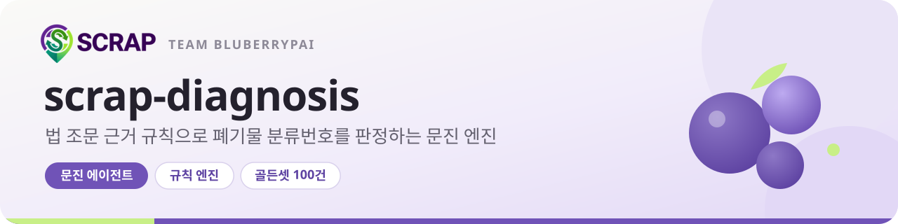

<div align="center">



<br>


[구조](#구조) · [AI가 하는 일](#ai가-하는-일) · [실행](#실행) · [검증](#검증) · [API 계약](docs/api/server-engine-contract.md)

</div>

폐기물 분류 문진 엔진(v2). 사용자의 답으로 폐기물 여부와 분류번호를 판정하고, 확정 결과를 인계 객체(`diagnosis-handoff-v1`)로 scrap-server에 넘긴다.

> [!IMPORTANT]
> **판정은 규칙 엔진만 한다.** 규칙은 조문 단위 근거와 함께 YAML로 두고, 정답 사례(골든셋)로 검증한다. 무엇을 물을지와 판정은 코드가 정하고, LLM은 사실 후보 제안·질문 답변·문장 다듬기만 한다.

- **범위**: PP·PE·PET(51-03-01, 51-03-07), 금속캔(51-29-03), 알루미늄·철 스크랩(51-29-02, 51-29-01). 지정폐기물은 "가능성"까지만 판단한다
- **범위 밖**은 "범위 밖 · 지원 예정"으로만 안내한다 (후보 코드는 trace에만 남긴다)

## 한 턴의 흐름

```
사용자 말 ─▶ 추출 AI(사실 후보 + 근거 문구) ─▶ 검사기(카탈로그·근거 문구 대조)
                                                   │ 통과한 값만
버튼 답 ───────────────────────────────────────────┤
                                                   ▼
                    규칙 엔진(3값 논리 판정) ─▶ 다음 질문 계산기 ─▶ 질문 다듬기 AI ─▶ 질문 카드·판정 보드
사용자 질문 ─▶ 질의응답 에이전트(읽기 전용 도구) ─▶ 출처 대조한 답변
```

## AI가 하는 일

| 구성 | 종류 | 하는 일 | 코드가 지키는 것 |
| --- | --- | --- | --- |
| 추출 AI | LLM 호출 1회/턴 | 사용자 말에서 의도와 사실 값 후보를 뽑음 | 키·값이 카탈로그 안이고 근거 문구가 실제 말에 있어야 기록. 추측 값은 확인 버튼으로 한 번 더 ([guard.py](app/interview/guard.py)) |
| 질의응답 에이전트 | 도구 루프 | "왜 묻나요", 용어, 기준·결과의 근거에 자료를 찾아 답함 | 도구는 읽기 전용(`search_law`·`rule_basis`·`lookup_term`·`case_state`), 호출 상한 3회, 도구가 돌려준 출처만 인용 ([assist.py](app/llm/assist.py)) |
| 질문 다듬기 AI | LLM 호출 | 계산기가 고른 질문을 쉬운 한두 문장으로 | 선택지·숫자가 바뀌면 버리고 고정 문장 사용 ([phrase.py](app/llm/phrase.py)) |
| 시험성적서 읽기 | PDF 표 / OCR | 서류 표 값을 검수 대기 후보로 | 글자 있는 PDF는 엔진 안에서 읽음. 스캔본·사진은 `ALLOW_DOCUMENT_OCR=true`일 때만 Azure Document Intelligence |

LLM이 꺼져 있으면(`LLM_PROVIDER=off`) 버튼 답만 받고 나머지는 그대로 동작한다. 사용자 말은 식별 정보를 가린 뒤 모델에 보낸다 ([redact.py](app/llm/redact.py)).

## 구조

| 경로 | 내용 |
| --- | --- |
| `knowledge/law/` | 법령 원문(조문 단위 JSON)과 수집 목록. `targets.yaml`(사람이 정함) → `tools/collect_law.py` → `articles/`, `manifest.yaml`. 법령 검색 평가 질문 `search_eval.yaml` |
| `knowledge/flow/` | 판정 규칙(`10_is_waste`~`70_code`), 사실 카탈로그(`facts.yaml`), 문진 계획(`plan.yaml`), 결과 안내(`outcomes.yaml`), 용어집(`glossary.yaml`), 결정 기록(`decisions.md`), 규칙 형식(`SCHEMA.md`) |
| `knowledge/cases/` | 골든셋(정답 사례 100건, 동결 해시 `golden.lock`), 결정표, 주석·평가 기록 ([README](knowledge/cases/README.md)) |
| `app/engine/` | 규칙 실행기(`flow.py`, 3값 논리), 수치 구간 값(`ranges.py`), 다음 질문 계산기(`planner.py`), 지식 로더(`kb.py`) |
| `app/interview/` | 문진 서비스(`service.py`), 말 이해(`understand.py`), 검사기(`guard.py`), 카탈로그 도우미(`catalog.py`), 질문 카드·판정 보드·결과 카드·인계 객체(`present.py`), 서류 업로드·검수·적용·해제(`documents.py`) |
| `app/llm/` | LLM 연결(`client.py`), 식별 정보 가리기(`redact.py`), 추출 AI(`extract.py`), 질의응답 에이전트(`assist.py`, 도구 `tools.py`, 법령 BM25 검색 `law_search.py`), 질문 다듬기(`phrase.py`) |
| `app/reading/` | 시험성적서 표 읽기 (글자 PDF는 pdfplumber, 스캔본·사진은 Azure Document Intelligence) |
| `app/api/` | 내부 API `/internal/v1` (Bearer 인증, 오류 형식) |
| `app/persistence/`, `alembic/` | DB 모델과 마이그레이션 (SQLite·PostgreSQL) |
| `tools/` | 법령 수집·변경 감지, 골든셋 빌드·검사, 규칙 비교, 가상 문진, 평가 |

## API

scrap-server만 부르는 내부 API. 모든 경로는 `Authorization: Bearer <ENGINE_SERVICE_TOKEN>`이 필요하다. 계약: [docs/api/server-engine-contract.md](docs/api/server-engine-contract.md)

| 메서드 | 경로 | 설명 |
| --- | --- | --- |
| POST · GET | /internal/v1/cases | 건 만들기 + 첫 질문 / 기업의 건 목록 |
| GET | /internal/v1/cases/{id} | 건 상세 |
| POST | /internal/v1/cases/{id}/diagnosis/messages | 문진 답변 (말 또는 버튼) |
| POST | /internal/v1/cases/{id}/confirm · reopen · rebase | 판정 확정(인계 객체) · 다시 열기 · 바뀐 규칙으로 재평가 |
| POST | /internal/v1/cases/{id}/documents (+ versions · values/apply · revoke) | 서류 업로드·교체·검수 값 반영·효력 해제 |
| GET | /internal/v1/cases/{id}/trace | 판정 근거 추적 |
| GET | /internal/v1/catalog/facts | 사실 카탈로그 (라벨·선택지) |
| DELETE · GET | /internal/v1/companies/{external_id}/data (· /deletion) | 기업 데이터 삭제 (회원 탈퇴) · 최근 삭제 이력 |
| GET | /health | 상태 확인 (인증 없음) |

## 실행

```bash
uv sync
uv run uvicorn app.main:app --port 8030      # API 문서 http://localhost:8030/docs
```

- 기본 DB는 `./diagnosis.db`(SQLite, 시작할 때 테이블을 만든다). 운영은 `DATABASE_URL=postgresql+psycopg://…`, `DB_CREATE_ALL=false`로 두고 `uv run alembic upgrade head`로 스키마를 만든다
- 개발용 PostgreSQL: `docker compose up -d db`(호스트 포트 55432). `docker compose --profile app up -d`는 엔진 컨테이너까지
- `ENGINE_SERVICE_TOKEN`을 비워 두면 개발 모드에서는 토큰 없이 통과한다. `APP_ENV=prod`에서 비어 있으면 모든 요청이 401이다
- scrap-server는 `DIAGNOSIS_ENGINE_URL=http://127.0.0.1:8030`과 같은 `ENGINE_SERVICE_TOKEN`으로 띄운다. 전체 서비스는 scrap-infra의 통합 compose로 띄운다

### 환경변수

전체 목록은 [.env.example](.env.example).

| 변수 | 설명 |
| --- | --- |
| `APP_ENV` | `dev`(기본) · `prod` |
| `ENGINE_SERVICE_TOKEN` | `/internal/v1` Bearer 토큰. server와 같은 값. prod 필수 |
| `DATABASE_URL`, `DB_CREATE_ALL` | DB 주소, 시작 시 테이블 생성 여부 (운영은 false + alembic) |
| `LLM_PROVIDER`, `AZURE_OPENAI_*` | `azure`면 말 이해·질의응답·질문 다듬기를 켬. `off`(기본)면 버튼 답만 |
| `LLM_TIMEOUT_SECONDS` | 모델 호출 대기 (기본 20초). server의 엔진 대기는 이 값 × 4보다 커야 함 |
| `EXTRACT_REASONING_EFFORT`, `RESPOND_REASONING_EFFORT` | 추론 강도 (`minimal`~`high`) |
| `ASSIST_MAX_TOOL_CALLS`, `PHRASE_QUESTIONS` | 질의응답 도구 호출 상한(기본 3), 질문 다듬기 켜기(기본 true) |
| `DOCUMENT_TABLE_READING`, `ALLOW_DOCUMENT_OCR`, `AZURE_DOCINTEL_*` | 서류 표 읽기. OCR은 켜고 키를 넣을 때만 Azure로 보내며 쪽마다 과금 |
| `LAW_API_OC` | 국가법령정보 OPEN API 인증값 (법령 수집·변경 감지 도구 전용, 서버는 부르지 않음) |

## 검증

```bash
uv run python -m pytest -q                          # 단위·API 테스트 (골든셋 100건을 API로 끝까지 문진하는 테스트 포함)
uv run ruff check . && uv run ruff format --check .
uv run python tools/check_cases.py                  # 골든셋 근거·값 검사
uv run python tools/build_decision_table.py --check # 결정표 생성물이 최신인지
uv run python tools/build_golden.py --check         # 골든셋 동결 해시
uv run python tools/compare_flows.py score knowledge/flow   # 판정 규칙 채점 (현재 완전 일치 100/100, 출력 클래스 일치 100/100)
uv run python tools/simulate_interview.py           # 문진 계획: 결론 정확도·질문 수
uv run python tools/eval_understand.py --mock       # 말 이해 흐름 (AI 없이 기준선). --oracle은 상한선, 옵션 없이는 실제 AI(비용 듦)
uv run python tools/eval_law_search.py              # 법령 검색 평가 (dev). --split test는 검색 방식을 다 고친 뒤에만
uv run alembic check                                # 모델과 마이그레이션이 같은지
TEST_DATABASE_URL=postgresql+psycopg://wd:wd@localhost:55432/postgres uv run python -m pytest -q
```

> [!TIP]
> Windows에서 `uv run pytest`가 "trampoline" 오류로 실패하면 `uv run python -m pytest`로 실행한다.

## 자동화

| 워크플로 | 하는 일 |
| --- | --- |
| [ci.yml](.github/workflows/ci.yml) | 린트, 골든셋·결정표·판정 규칙 일관성, PostgreSQL 마이그레이션 왕복, 테스트(SQLite·PostgreSQL), 가상 문진, 말 이해 흐름(AI 호출 없음) |
| [deploy-azure.yml](.github/workflows/deploy-azure.yml) | main 병합 시 이미지를 ACR `:main`으로 push → ACR 웹훅으로 App Service 재시작 |
| [law-change-alert.yml](.github/workflows/law-change-alert.yml) | 매일 09:17 KST에 추적 중인 법령·행정규칙 변경을 감지해 Discord로 알림 (`tools/check_law_updates.py`, 스냅샷·규칙은 바꾸지 않음) |

## 아직 없는 것

- 판례·행정심판 외부 정답 (API 승인 후 `tools/collect_external_cases.py` 재실행)
