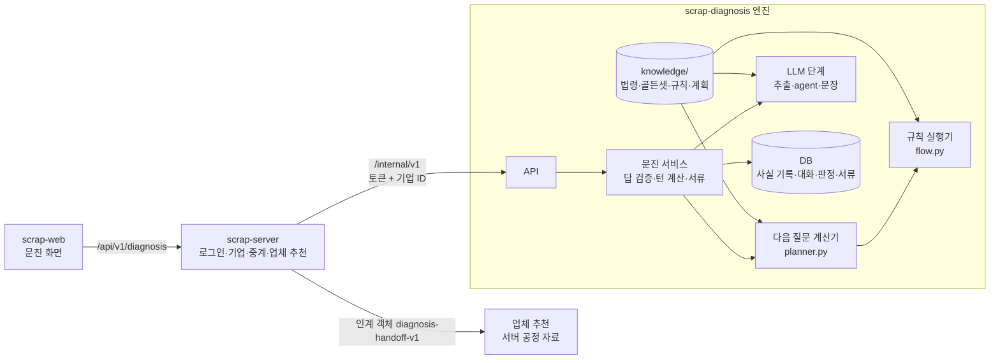
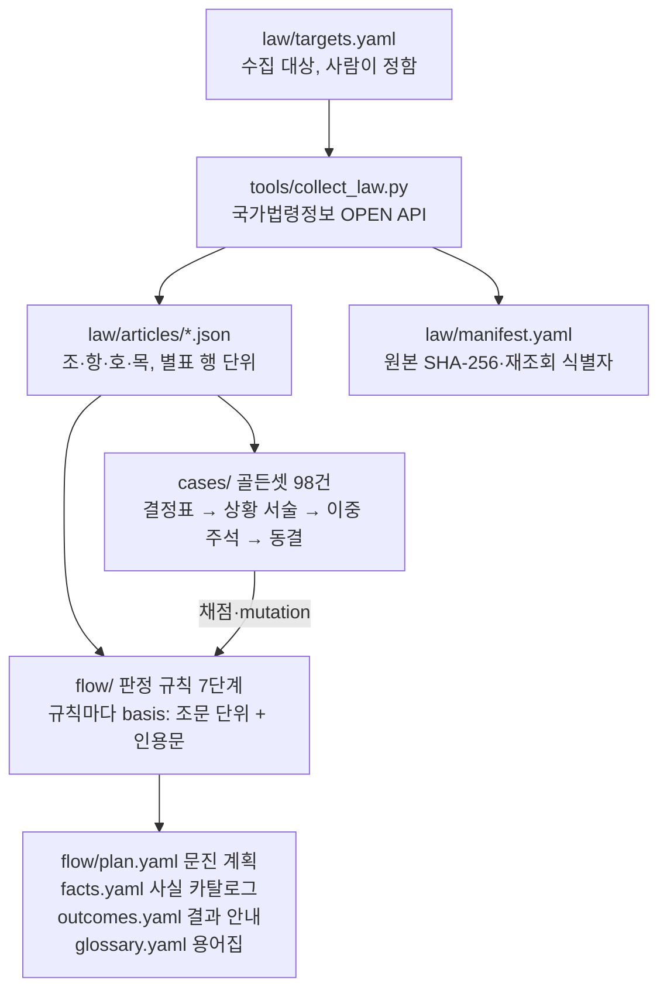
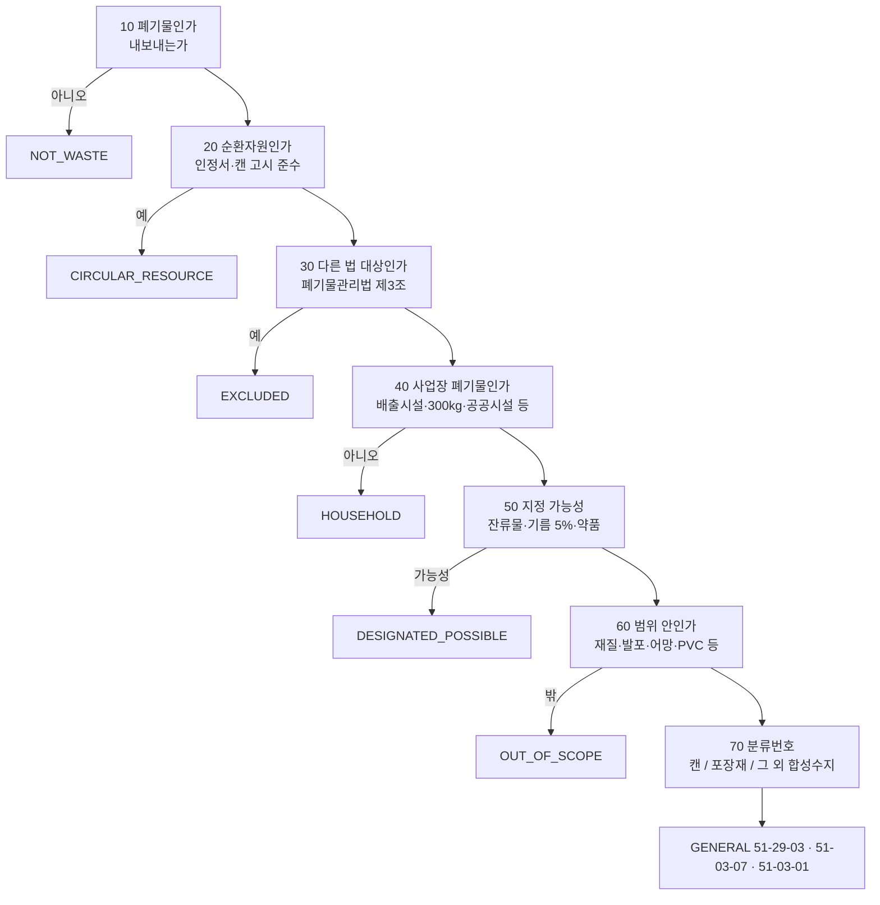
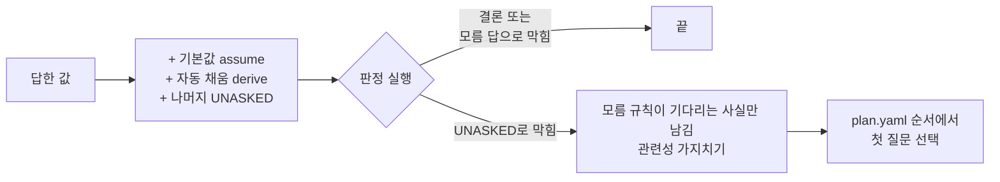
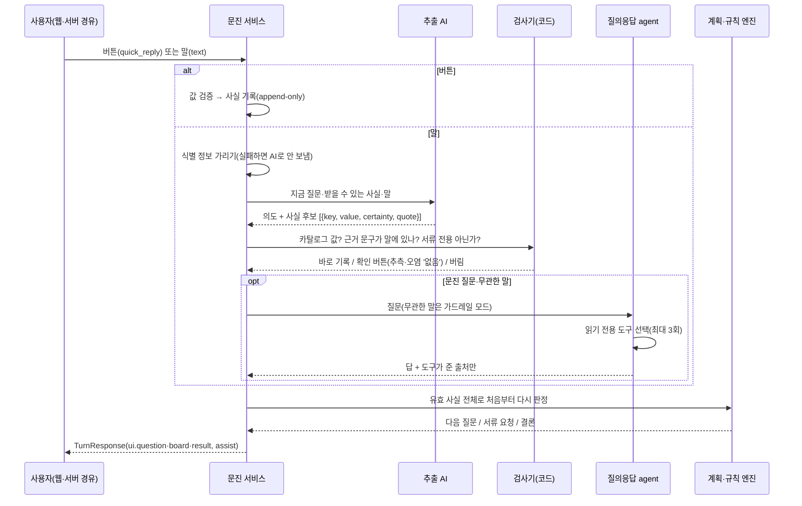
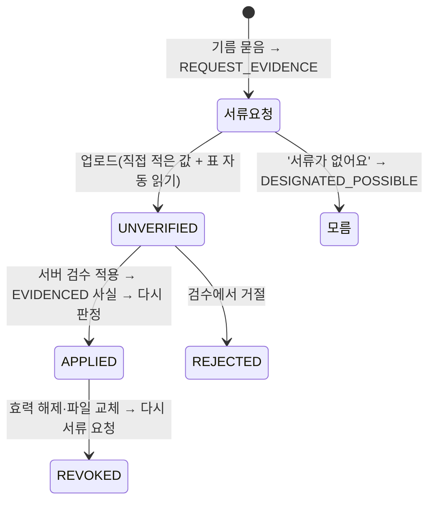

# 문진 엔진 v2 설계서

기준: `feat/diagnosis-v2`(2026-11-20). 세부 규약은 [API 계약](../api/server-engine-contract.md), 해석 결정은 [decisions.md](../../knowledge/flow/decisions.md)에 있다.

## 1. 범위와 원칙

| 항목 | 내용 |
|---|---|
| 대상 | PP·PE·PET(51-03-01 폐합성수지류, 51-03-07 플라스틱폐포장재), 알루미늄 캔(51-29-03 폐금속캔류) |
| 지정폐기물 | "가능성"까지만 판단(DESIGNATED_POSSIBLE) |
| 범위 밖 | "범위 밖 · 지원 예정"으로만 안내, 후보 코드는 trace에만 |
| 결과 8종 | NOT_WASTE, CIRCULAR_RESOURCE, EXCLUDED, HOUSEHOLD, DESIGNATED_POSSIBLE, OUT_OF_SCOPE, GENERAL(번호), INSUFFICIENT_INFO |

원칙
- **판정은 규칙 엔진만.** 규칙은 조문 단위 근거와 함께 YAML로 두고 골든셋으로 검증한다.
- **LLM은 제안·설명·문장만.** 사실 후보는 코드 검사기를 통과해야 기록되고, 무엇을 물을지는 코드가 정한다.
- **법령은 API로만 받는다.** 손으로 옮기지 않는다.

## 2. 전체 구조

## 3. 지식 구축 (knowledge/)

| 단계 | 산출물 | 검증 |
|---|---|---|
| 법령 적재 | 법령 7·고시 2·해석례 2, 쓰는 조문만 + 별표 4의3(재활용 유형) | 원본 해시, 재수집 시 diff |
| 골든셋 v3 | 98건, 등급 A/C, 동결 해시 `e6ca9d60fe90` | 블라인드 이중 주석 κ 1.00, mutation 152/152 검출 |
| 판정 규칙 | 두 모델(opus·sonnet) 독립 초안 → 비교 → 판정 조정 → 최종 | 골든 98/98 |

## 4. 판정 흐름 (app/engine/flow.py)

- 3값 논리(Kleene): 참·거짓·모름. 단계 안은 첫 참 규칙을 적용하고, 참에 닿기 전에 모름을 만나면 그 자리에서 멈춘다(INSUFFICIENT_INFO + blocking_facts).
- 아직 묻지 않음(UNASKED)과 모른다고 답함(unknown)을 구분한다. UNASKED는 어떤 비교든 모름이다.
- 구간 값(불검출, "0.5 미만")은 구간 전체가 조건을 만족하면 참, 전혀 아니면 거짓, 걸치면 모름이다.

## 5. 문진 계획과 다음 질문 (app/engine/planner.py)

| 계획 요소 | 예 |
|---|---|
| 순서 | 재질 → 형태 → 발포·어망 → 포장 → 캔 내용물 → 오염 → 기름 성적서 → 법 적용 → 순환자원 → 캔 고시 → 사업장 |
| derive(자동 채움) | 형태를 고르면 고체, 알루미늄 + 캔이면 캔 재질 |
| assume(기본값, D17) | 내보내는 물질로 본다. 결과에 가정으로 표시, 보드에서 고침 |
| always | 형태: 판정과 무관해도 업체 추천에 넘기려고 묻는다 |
| ask_if / options_by / variants | 조건부 질문, 재질별 형태 선택지, 범위 안 고체면 방사성 오염만 묻기(D16) |
| 묶음(group) | 모두 해당 없음 / 체크한 항목만 / 하나씩. 체크한 항목은 값이 하나면 바로 기록, 여럿이면 '해당 없음'을 뺀 세부 질문 |
| scope: company | 사업장 질문 5개는 기업별로 기억해 다음 건에 미리 채움 |
| why·basis | 질문마다 이유 한 줄 + 그 답을 기다리는 규칙의 근거 조문(펼침) |

## 6. 한 턴 처리

턴 분기: `ASK_FACT`(질문) · `REQUEST_EVIDENCE`(서류 요청) · `FINAL_REVIEW`(결론, 확정 가능) · `UNSUPPORTED`(모름 답으로 막힘). 확인 카드는 `sub_branch: CONFIRM_GUESS`.

## 7. LLM 단계 (app/llm/)

| 구성 | 하는 일 | 코드가 지키는 것 |
|---|---|---|
| 추출 AI (`extract.py`) | 의도 5종, 사실 후보, 묶음 '모두 해당 없음'. 건 메모도 같은 흐름 | 검사기 통과분만 기록, 추측·오염 '없음'은 확인 버튼 |
| 질의응답 agent (`assist.py`, `tools.py`) | 도구 `rule_basis`·`search_law`·`lookup_term`·`case_state`를 스스로 골라 답 | 읽기 전용, 호출 3회 상한, 도구가 준 출처만 인용 |
| 가드레일 | 잡담·문진 밖 요청·역할 바꾸기 시도 → 짧게 받고 문진으로 | 기록 없음, 500자 제한, 분류번호 금지, 실패 시 고정 문장 |
| 문장 다듬기 (`phrase.py`) | 턴 message만 쉬운 말로 | 카드 문장·선택지 고정, 원문에 없는 숫자 금지, 같은 질문 1회 호출 |
| 가리기 (`redact.py`, 복원) | 전화·이메일·사업자번호·주소 → 토큰 | 남으면 AI로 보내지 않음, Trace엔 해시만 |

워크플로(①~⑤)와 agent(⑥)를 나눈 하이브리드다. 판정 경로는 결정적이고, 질의응답만 LLM이 자료 조회 경로를 정한다.

## 8. 서류(성적서)

- 서류 전용 사실(기름성분 함량)은 버튼으로 받지 않는다(422).
- 표 자동 읽기: 글자 PDF는 엔진 안(pdfplumber), 스캔본·사진은 Azure Document Intelligence(기본 꺼짐). `app/reading/`은 기존 엔진에서 복원.

## 9. 확정과 인계

| 출력 | 내용 |
|---|---|
| 인계 객체 `diagnosis-handoff-v1` | result_type·waste_code·category·route_guidance.action, facts(형태 포함), basis, evidence, assumptions, recycling |
| 재활용 유형 `recycling-types-v1` | 별표 4의3 행(API 수집), free·analysis 유형, 출처·체크섬 |
| outcome → action | GENERAL→RECOMMEND_ROUTE, NOT_WASTE·CIRCULAR→NO_ROUTE_NEEDED, EXCLUDED→REFER_OTHER_LAW, HOUSEHOLD→REFER_MUNICIPALITY, DESIGNATED_POSSIBLE→NEEDS_TEST, OUT_OF_SCOPE→MANUAL_CLASSIFICATION |

서버 `context_from_handoff`로 PP·PET·알루미늄 캔이 업체 후보 조회(`ready`)까지 가고, 형태는 인계 객체에서 바로 읽힌다.

## 10. 저장

| 테이블 | 용도 |
|---|---|
| companies, company_facts | 기업(서버 ID로 자동 생성), 사업장 답 기억 |
| cases | 상태·kb_version·펼친 묶음·확인 대기·질문 수(낙관적 잠금) |
| fact_records | 사실 이력 append-only(CLAIMED·EVIDENCED·DECLARED_UNKNOWN·RETRACTED, 출처·근거 문구) |
| messages, trace_events | 대화(assist 포함), 턴마다 입력·판정·AI 호출 기록. 확정 시 trace 불변 |
| verdicts | 확정 버전, 인계 객체. reopen 표시만 허용 |
| documents, document_values | 서류 메타(원문 미저장), 값 후보·검수 상태 |

마이그레이션 Alembic 0001~0003. 규칙이 바뀌면 진행 중 건은 `KB_CHANGED` → rebase.

## 11. 검증 결과

| 항목 | 결과 |
|---|---|
| 판정 규칙 vs 골든셋 | 98/98 |
| 가상 문진(버튼만) | 결론 98/98, 평균 8.3문항 |
| 골든 98건 API 끝까지 문진(서류 흐름 포함) | 통과 |
| 실제 AI 98건(메모 = 상황 서술) | 결론 98/98, 버튼 7.9 → 4.9, 추출 정밀도 98.5%·재현율 72%, 오염 '없음' 오답 0, 지연 중앙값 6.0초 ※ 질문 분리(D16·D17) 전 계획으로 측정 |
| 완벽 추출 가정(oracle) | 결론 98/98, 버튼 2.6 |
| 테스트 | 201개 통과(서류 읽기 복원분 103개 포함) |
